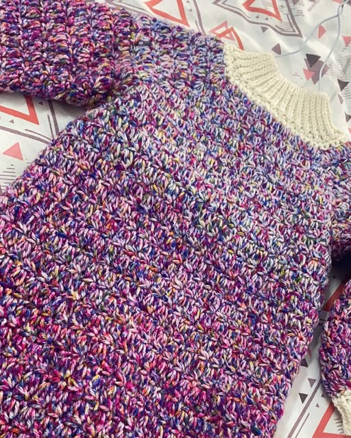

# ꧁ The Crochet Boutique ꧂ (@croche_boutiq)

An ultra-modern, frosted glassmorphism boutique web application handcrafted for [@croche_boutiq](https://www.instagram.com/croche_boutiq/) on Instagram.



## ✨ Highlights & Features

- **100% Authentic Instagram Assets**: Every image across the store is extracted directly from `@croche_boutiq`'s official Instagram posts (Crochet bags, winter scarves, baby rompers, summer beachwear, and accessories).
- **Modern Glassmorphism UI**:
  - Dynamic ambient glowing aurora orbs in the background creating luminous refraction effects.
  - Multi-layer frosted glass cards with `backdrop-filter: blur(20px)`, specular reflections, and soft drop shadows.
  - Interactive 3D hover effects, micro-interactions, and toast alerts.
  - Light Frost and Dark Obsidian theme toggle.
- **Navbar & Collapsible Glass Sidebar**:
  - Sticky glass navbar with logo, verified boutique badge, quick navigation, currency switcher, wishlist counter, and cart badge.
  - Collapsible glass sidebar drawer with category directory, role badge, and direct Instagram links.
- **Role-Based Authentication**:
  - **👑 Store Owner**: Full admin access, 50-image batch upload studio, inventory management, price editing, and catalog backups.
  - **⚙️ Store Manager**: Product management and batch image uploading.
  - **🛍️ Customer**: Product browsing, wishlist, bag, and bespoke custom order quote builder.
  - Includes **1-Click Demo Login** buttons to immediately test any persona.
- **Owner & Manager Studio (50-Picture Batch Upload)**:
  - Drag & drop zone with strict enforcement of maximum **50 pictures per upload batch**.
  - Live preview grid with staged thumbnails, remove buttons, and `#1` to `#50` counter badges.
  - Batch metadata configuration (Item title, category, price in ₹ INR, care instructions).
  - Canvas-based image compression with persistent `localStorage` saving.
- **Shopping Bag & Checkout**:
  - Slide-out glass cart drawer with quantity controllers, promo codes (`CROCHE10`), and free shipping progress meter.
  - Direct checkout routing to **WhatsApp** and **Instagram DM** ([@croche_boutiq](https://ig.me/m/croche_boutiq)).
- **Multi-Currency System**:
  - Live conversion between ₹ INR, $ USD, € EUR, and £ GBP.

---

## 🚀 Getting Started

Simply open `index.html` in any modern web browser or serve via a local HTTP server:

```bash
# Python 3
python -m http.server 3000

# Node.js
npx serve
```

Visit `http://localhost:3000` in your browser.

---

## 📁 Project Structure

```text
Croche Boutique/
├── index.html            # Main HTML5 structure with glassmorphism layout & modals
├── style.css             # Glassmorphism design system & responsive styling
├── app.js                # Core JS logic: roles, uploader, cart, catalog, and storage
├── assets/
│   └── images/           # 24 authentic photos extracted from @croche_boutiq
├── images/               # Image mirror directory
├── README.md             # Project documentation
└── .gitignore            # Git ignore configuration
```

---

## 🧶 Credits

- **Boutique Artisan**: [@croche_boutiq](https://www.instagram.com/croche_boutiq/) on Instagram.
- Handmade with love and fine yarn.
